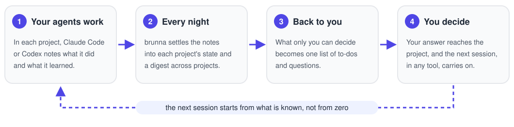
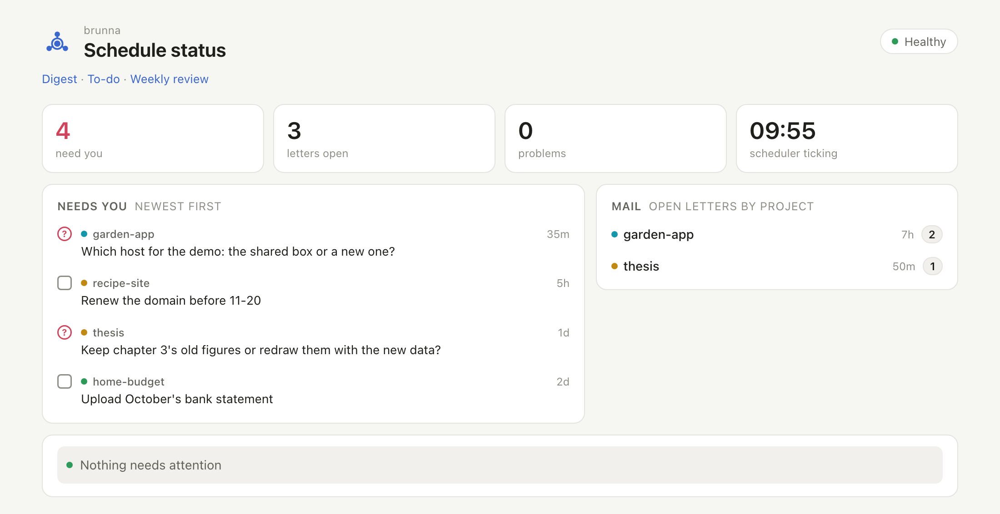
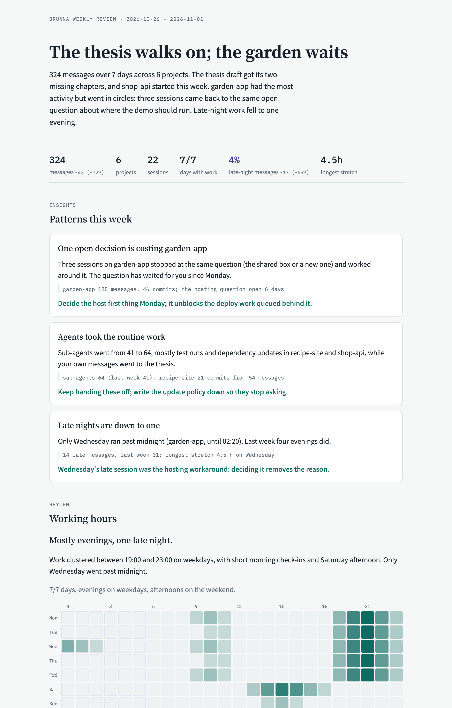

<p align="center">
  <picture>
    <source media="(prefers-color-scheme: dark)" srcset="assets/logo/wordmark-dark.svg">
    
  </picture>
</p>

<p align="center">
  <a href="https://github.com/imaknas/brunna/actions/workflows/ci.yml"></a>
  <a href="https://github.com/imaknas/brunna/releases"></a>
  <a href="LICENSE"></a>
</p>

<p align="center">English · <a href="README.zh-Hant.md">&#32321;&#39636;&#20013;&#25991;</a></p>

**Many projects, run by AI agents. Each one remembers, and you decide.**

brunna sits under your AI coding agents (Claude Code, Codex and others) on a computer you own. Your agents write
down what they do and learn; every night brunna settles those notes into each project's current state and gathers
what matters across all your projects, so nothing is lost between sessions or tools. What only you can decide comes
back to you, as one list.

brunna was called agent-hub until v0.7. An install from before keeps its folders and both commands; see
[docs/upgrading.md](docs/upgrading.md#from-agent-hub).

<picture>
  <source media="(prefers-color-scheme: dark)" srcset="assets/readme/loop-dark.svg">
  
</picture>

What you see: the status page on your own machine, with every project's open questions and to-dos for you, newest
first, the mail your agents left each other, and whether the nightly work ran (made-up projects).

<picture>
  <source media="(prefers-color-scheme: dark)" srcset="assets/readme/status-page-dark.png">
  
</picture>

And every Monday, how your week went:

<picture>
  <source media="(prefers-color-scheme: dark)" srcset="assets/readme/weekly-review-dark.png">
  
</picture>

## Install

**With a terminal** (macOS or Linux). It installs brunna, then asks a few questions, the first one being the
language:

```bash
curl -fsSL https://raw.githubusercontent.com/imaknas/brunna/main/install.sh | sh
```

**Without a terminal**: paste this into Claude Desktop's Code tab or the Codex app, and answer in the chat
([how that works](#set-up-through-your-agent)):

> Install brunna for me from https://github.com/imaknas/brunna. Follow its "Set up through your agent" steps,
> ask me each question in this chat, and tell me before anything is installed.

By hand, requirements, machines that sleep and where things are kept: [docs/install.md](docs/install.md).

## Getting started

1. Connect the folders you already have. brunna works out whether each is one project, a monorepo or a folder of
   repos, and asks:

   ```bash
   brunna connect ~/code
   ```

2. Open your agent in a project's folder (`claude` or `codex`). Claude Code picks up the project's setup when the
   session starts, and writes notes as it works; Codex reaches the mailbox and the notes through brunna's tools (MCP)
   for now.
3. `brunna doctor` says what is still missing, each with how to fix it. The status page at http://localhost:18790
   shows how everything is doing, no terminal needed
   ([from another computer](docs/install.md#the-status-page-from-another-computer)).

The next morning, the digest and the to-do list are waiting:

```markdown
# Cross-project to-do

## Only the owner can do
### shop-api
- [ ] Decide whether refunds need a second approval
## An agent can do
### thesis
- [ ] Re-run chapter 3's figures with the corrected dataset
```

## What it does

- **Projects that remember.** Notes live beside each project, apart from its code, and each project keeps a current
  state that is corrected as things change.
- **One morning view.** A digest of what happened across all projects, and one to-do list: what only you can do, what
  needs a decision first, what an agent can pick up. Every Monday, a review of how your week went.
- **You decide.** What only you can settle goes to you (or to your personal assistant, through the open
  [Principal Handoff](https://doi.org/10.5281/zenodo.23852711) protocol) and comes back to the project when you answer.
- **Projects talk to each other.** A mailbox between projects; a request nobody picks up gets an agent sent to it.
- **It runs on its own.** A scheduler with a watchdog, each project's background services, alerts, and a status
  page. A laptop that sleeps catches up when it wakes.
- **Safe by default.** Sandboxed projects can't read each other or your credentials; credentials are checked and
  never printed; backups are encrypted.
- **English or Traditional Chinese**, for what you read and what your agents write.

Everything it does, in detail: [docs/features.md](docs/features.md).

## Works with

| What | Options |
|---|---|
| Your AI agent | Claude Code: everything. Codex: its chats reach the mailbox through brunna's tools (MCP); brunna's own background work and decisions don't run on it yet (they use a model provider meanwhile). Any CLI agent with a headless mode, or one that speaks the [Agent Client Protocol](https://agentclientprotocol.com/), can handle mailbox requests in a throwaway copy, through an adapter |
| The model behind brunna's decisions | Your agent's own login, Anthropic, any OpenAI-compatible API, or a local Ollama (`brunna llm setup`) |
| The computer | macOS or Linux. An always-on machine is best; a laptop works |

No agent and no model yet? Notes, schedules and the mailbox still work; `brunna doctor` says what is off and why.

## Privacy and safety

- Everything stays on your computer: your settings, notes and keys are in `~/.brunna`, never in the repo.
- Model calls go only to the provider you chose. The weekly reflection sends statistics, never conversation text.
- brunna never receives your Claude login: you make and save the token yourself, and brunna only checks that
  it works.
- Vulnerabilities: [SECURITY.md](SECURITY.md).

## Set up through your agent

While your AI app installs brunna, some things are asked of you directly, never through the chat: a yes/no in a
window on your screen (installing software, a setting for your user, a folder agents may connect), and a key on a page
it opens in your browser. Answer them there, not in the chat.

<details>
<summary><b>Steps for the agent</b></summary>

Every command ends with one JSON line; `needs_user` means something only the user can do: tell them, wait until they
say it's done, then run the same command again.

1. Run `curl -fsSL https://raw.githubusercontent.com/imaknas/brunna/main/install.sh | sh -s -- --for-agent`. It
   installs nothing that needs the user's consent itself. Its last line is `{"done": true, "next": "<command>"}`,
   `{"needs_user": …}` (exit 3) or `{"error": …}`.
2. Run the `next` command (`… brunna init --questions`). Keep using that full path for `brunna` in the steps below:
   it may not be on PATH until a new shell. It lists the questions as JSON, each with an `id`, `text`,
   `default`, `choices` where there are some, and `via`. Ask the user the `via: chat` ones in the chat, offering the
   default. Never ask for `via: page`, `via: dialog` or `via: user` ones: brunna asks the user those directly, or
   tells them what to do.
3. Write the answers to a file as one JSON object (`{"owner": "…", "agent": "claude", …}`) and run
   `… brunna init --questions --answers <file>`: answers can bring new questions (a provider's model). Repeat until
   it lists no chat question (an answered one, `""` for skip included, isn't listed again).
4. Tell the user to watch their screen for brunna's windows and pages, then run `… brunna init --answers <file>`.
   On a machine with a screen it waits up to 10 minutes on each window or page, so run it in the background or with a
   long timeout; without a screen (SSH, a container) it doesn't wait and hands them back. The last
   line is `{"done": …, "needs_user": [...]}`; for anything in `needs_user`, tell the user, then run it again.
5. Run `… brunna doctor` and tell the user what it says is missing. Afterwards the user sees how things are at
   http://localhost:18790, and in any chat can ask to connect a folder or what's waiting for them.

</details>

## Documentation

| Topic | Where |
|---|---|
| Installing, requirements, machines that sleep, where things are kept, uninstalling | [docs/install.md](docs/install.md) |
| Everything brunna does, in detail | [docs/features.md](docs/features.md) |
| Everyday commands | [docs/commands.md](docs/commands.md) |
| Updating, and going back | [docs/upgrading.md](docs/upgrading.md) |
| The mailbox for any agent (MCP) | [docs/mcp.md](docs/mcp.md) |
| Using it with herdr, and a status line for other tools (`brunna glance`) | [docs/herdr.md](docs/herdr.md) |
| How each part is designed | [docs/design/](docs/design) |
| Interfaces shared with other systems | [contracts/](contracts) |
| Working on brunna itself (people and agents) | [CONTRIBUTING.md](CONTRIBUTING.md), [AGENTS.md](AGENTS.md) |
| What changed in each release | [CHANGELOG.md](CHANGELOG.md) |
| Pitfalls met so far | [known-issues.md](known-issues.md) |

## License

[Apache-2.0](LICENSE), including the contracts in `contracts/` and the copies of them vendored into other repos.
