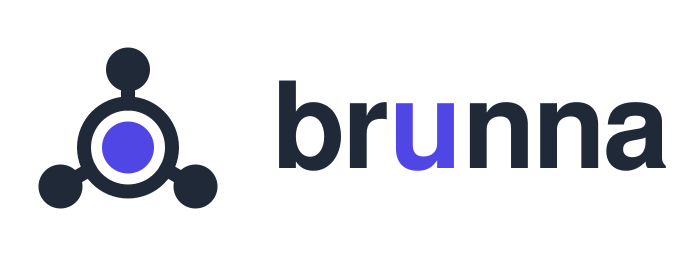
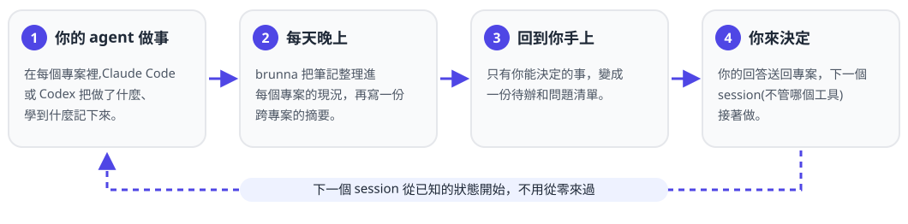

<p align="center">
  <picture>
    <source media="(prefers-color-scheme: dark)" srcset="assets/logo/wordmark-dark.svg">
    
  </picture>
</p>

<p align="center">
  <a href="https://github.com/imaknas/agent-hub/actions/workflows/ci.yml"></a>
  <a href="https://github.com/imaknas/agent-hub/releases"></a>
  <a href="LICENSE"></a>
</p>

<p align="center"><a href="README.md">English</a> · 繁體中文</p>

**很多專案，交給 AI agent 去跑。每個專案都記得自己的事，由你來決定。**

agent-hub 在你自己的電腦上，墊在你的 AI coding agent(Claude Code、Codex 等)底下。你的 agent 會把做了什麼、學到
什麼記下來;每天晚上 agent-hub 把這些筆記整理進每個專案的目前狀態，再把所有專案裡重要的事收在一起，換了 session
或換了工具，東西都不會掉。只有你能決定的事，會整理成一份清單回到你手上。

<picture>
  <source media="(prefers-color-scheme: dark)" srcset="assets/readme/loop.zh-Hant-dark.svg">
  
</picture>

## 安裝

**會用終端機**(macOS 或 Linux):貼這一行，裝好後它會問你幾個問題，第一題是語言:

```bash
curl -fsSL https://raw.githubusercontent.com/imaknas/agent-hub/main/install.sh | sh
```

**不用終端機**:把下面這段貼進 Claude Desktop 的 Code 分頁或 Codex App,在對話裡回答它
([過程怎麼進行](#交給你的-ai-app-安裝)):

> 幫我從 https://github.com/imaknas/agent-hub 安裝 agent-hub。照它 README 裡「Set up through your agent」的步驟做,
> 每個問題都在這個對話裡問我，要安裝任何東西之前先告訴我。

手動安裝、需求、會睡眠的電腦、檔案放在哪裡:[docs/install.md](docs/install.md)(英文)。

## 開始用

1. 接上你已經有的資料夾。agent-hub 會判斷每個資料夾是一個專案、一個 monorepo,還是一個放了好幾個 repo 的資料夾，
   再問你:

   ```bash
   agenthub connect ~/code
   ```

2. 在專案資料夾裡打開你的 agent(`claude` 或 `codex`)。session 開始時它會載入這個專案的設定，邊做事邊寫筆記。
3. `agenthub doctor` 會列出還缺什麼，每項都附上怎麼補。狀態頁 http://localhost:18790 讓你不開終端機也能看到
   一切是否正常。

隔天早上，摘要和待辦清單已經在等你:

```markdown
# 跨專案待辦

## 只有 Alex 能做
### shop-api
- [ ] 決定退款要不要第二個人核准
## agent 可以做
### thesis
- [ ] 用修正過的資料集重跑第三章的圖
```

## 它做什麼

- **記得自己的專案。** 筆記放在每個專案旁邊，跟程式碼分開;每個專案都有一份目前狀態，事情變了就跟著修正。
- **早上一眼看完。** 所有專案發生了什麼的摘要，加上一份待辦：只有你能做的、要先決定的、agent 可以接手的。
- **你來決定。** 只有你能拍板的事會交給你(或透過開放的 [Principal Handoff](https://doi.org/10.5281/zenodo.23852711)
  協定交給你的個人助理),你回答後再送回專案。
- **專案之間會溝通。** 專案之間有信箱;沒人接的請求，平台會派 agent 去處理。
- **自己會跑。** 排程和看門狗、各專案的背景服務、警報、狀態頁。會睡眠的筆電醒來後會補跑。
- **預設就安全。** 開了 sandbox 的專案讀不到彼此，也讀不到你的憑證;憑證會被檢查、從不顯示;備份有加密。
- **英文或繁體中文**,你看到的和 agent 寫的都可以選。

完整功能說明:[docs/features.md](docs/features.md)(英文)。

## 可以搭配

| 項目 | 可以用 |
|---|---|
| 你的 AI agent | Claude Code:全部功能。Codex:背景工作和判斷;它的對話透過 agent-hub 的工具(MCP)用信箱。任何有 headless 模式的 CLI agent,或支援 [Agent Client Protocol](https://agentclientprotocol.com/) 的 agent,透過轉接層接上 |
| agent-hub 做判斷用的模型 | 你的 agent 自己的登入、Anthropic、任何相容 OpenAI 的 API,或本機的 Ollama(`agenthub llm setup`) |
| 電腦 | macOS 或 Linux。一直開著的機器最好，筆電也可以 |

還沒有 agent 或模型?筆記、排程和信箱照樣能用;`agenthub doctor` 會說哪些功能關著、為什麼。

## 隱私與安全

- 一切都留在你的電腦上：設定、筆記和金鑰放在 `~/.agent-hub`,不在 repo 裡。
- 模型呼叫只送到你選的 provider。每週回顧只送統計數字，從不送對話內容。
- agent-hub 不經手你的 Claude 登入:token 由你自己產生、自己存,agent-hub 只檢查它能不能用。
- 回報漏洞:[SECURITY.md](SECURITY.md)。

## 交給你的 AI App 安裝

AI App 幫你安裝 agent-hub 的過程中，有些事會直接問你，不經過對話：螢幕上跳出的視窗問你「是/否」(安裝軟體、改你
使用者層級的設定、允許 agent 接上哪個資料夾),以及瀏覽器裡開一個頁面讓你輸入金鑰。請在那裡回答，不要貼進對話。

給 agent 的步驟在英文版 README 的「Set up through your agent」;貼上的那段話會叫 agent 去照著做。

## 文件(英文)

| 內容 | 文件 |
|---|---|
| 安裝、需求、會睡眠的電腦、檔案放在哪裡 | [docs/install.md](docs/install.md) |
| agent-hub 做的每件事 | [docs/features.md](docs/features.md) |
| 日常指令 | [docs/commands.md](docs/commands.md) |
| 更新與退回 | [docs/upgrading.md](docs/upgrading.md) |
| 給任何 agent 用的信箱(MCP) | [docs/mcp.md](docs/mcp.md) |
| 每個部分的設計 | [docs/design/](docs/design) |
| 跟其他系統共用的介面 | [contracts/](contracts) |
| 參與開發(人和 agent) | [CONTRIBUTING.md](CONTRIBUTING.md)、[AGENTS.md](AGENTS.md) |
| 每個版本改了什麼 | [CHANGELOG.md](CHANGELOG.md) |
| 目前踩過的坑 | [known-issues.md](known-issues.md) |

## 授權

[Apache-2.0](LICENSE),包括 `contracts/` 裡的介面，以及被複製到其他 repo 的那些副本。
