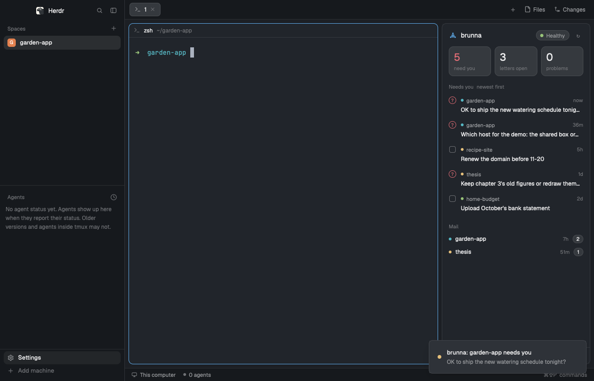

# brunna

[brunna](https://github.com/imaknas/brunna) keeps many projects run by AI agents on a machine you own: each project's
notes and state, schedules and nightly upkeep, a mailbox between projects, and a list of what only you can decide. It
works with Claude Code, Codex or any other agent. This is its panel in herdr: what needs you across every project,
the mail your agents left, and whether brunna is healthy, refreshed once a minute, with a toast when something new
needs you.

## What you see

One panel on the right, 320 px wide, on the theme's `surface`, 13 px text in `foreground`, top to bottom:

- **Header** (14 px padding): brunna's mark (`mark.svg`, 18 px, tinted `accent`), "brunna" in 14 px semibold, then on
  the right a pill (22 px high, `raised` with a `border`): a 7 px dot and "Healthy" (dot `ansi2`), "N problems"
  (`blocked`) or "Not known yet" (`unknown`); and a ↻ button (22 px, `hover` background) that refreshes.
- **Three tiles** (64 px high, 10 px radius, `raised`, `border`, 8 px apart): a 22 px semibold number over an 11 px
  `dim` label: "need you" (the number in `blocked` when above 0), "letters open", "problems" (`blocked` above 0).
- **Needs you** (section label 11 px medium `dim`, "newest first"): the owner's open items, newest first, at most 8.
  Each row (8 px radius, `hover` background): a mark (a 16 px `blocked` ring with "?" for a question, a 14 px
  rounded square for a to-do); a first line with the project's dot (6 px, one of `ansi1`…`ansi6` by the name, so a
  project keeps its color), the project in 11.5 px `muted` and how long ago on the right (11 px `dim`: now, 5m, 3h,
  2d); a second line with the text, 12.5 px, cut to one line. More than 8: "N more · brunna owner list". None: a
  `raised` row "Nothing needs you right now." with an `ansi2` dot.
- **Mail**: one 28 px row per project with open letters: the project's dot, its name, how old the oldest letter is,
  and the count in a small `raised` pill.
- **Problems** (only when there are any): up to 5 `bad` alerts, each with a `blocked` dot, 12 px `muted`.
- **Footer** (36 px, `border` on top, 11 px `dim`): a dot (`ansi2`, or `blocked` when the scheduler stopped) and
  "tick 4m ago"; on the right the time of the last refresh (or "refresh failed" in `blocked`, the error as tooltip)
  and "Status page ↗" in `accent` when the page opens from this computer.

The list between tiles and footer scrolls. Before the first answer, without brunna, or before `brunna init`, the
panel shows the mark (32 px) centered with one line: "Can't reach brunna" with the error and how to install it, or
"Run brunna init".

## How it behaves

- Every 60 seconds it runs `brunna glance --json` and redraws. Agent states (working, blocked, done, idle) are not
  shown: herdr's own sidebar has them; this panel is about what brunna keeps across sessions.
- When an item that wasn't in the previous answer needs you, a toast (`notify`, level `warning`): `brunna: <project>
  needs you` with the item's text, or `brunna: N new things need you`; never on the first load, at most one a minute.
- Clicking an item shows its whole text (wrapped); clicking again cuts it back to one line.
- "Status page ↗" opens the page in the browser (`cx.open_url`). ↻ runs `brunna.refresh`.
- A refresh you ask for (↻ or `brunna.refresh`) shows: ↻ turns `accent` and the footer says "Refreshing…" for at
  least half a second, then "✓ Up to date" (`ansi2`) for two seconds. The minute timer's refreshes don't.
- The command `brunna.refresh` (bind it in `keys.json`, e.g. `"global": { "ctrl-alt-b": "brunna.refresh" }`) refreshes
  at once.

## Built from

- `mods/brunna/main.js`: a `View` with `init` (first refresh, `cx.timer.every(60000, …)`, a `cx.spawn` loop on
  `nextCommand()`) and `render` (`v_flex` root: header, tiles, a scrolling `v_flex` list with
  `overflow_y_scrollbar()`, footer), built from `div`, `h_flex`, `v_flex` and `svg` only.
- `mods/brunna/mark.svg`: brunna's mark in one color, for `svg()` to tint.
- `mods/brunna/mod.json`: `{ "place": "right", "size": 320 }`.
- `herdr` functions: `exec`, `notify`, `props`, `theme`, `nextCommand`, `run`. `gpui-kit`: `View`, `div`, `svg`.
  `gpui-base`: `v_flex`, `h_flex`.
- Program: `brunna glance --json` (`exec`), tried as `brunna` on PATH, then `$HOME/.local/bin/brunna` through `sh -c`.
  Its output is the glance.v1 contract (`contracts/glance.v1.schema.json` in brunna's repo): `set_up`, `needs_you`
  (`kind`, `project`, `id`, `text`, `since`), `mail` (`total`, `projects`), `health` (`state`, `alerts`, `as_of`),
  `scheduler` (`last_tick`, `alive`), `status_page` (`url`, `local_to`).
- Props (optional): `cli`, the absolute path of brunna's command; `machine`, a herdr machine name when brunna runs on
  another computer (passed as `exec`'s `on`).

## Watch out

- The mod runs a program (`brunna`) on this computer, or on `machine`. It reads nothing else and reaches no network.
- `exec` runs with the user's environment, but an app started from the GUI may lack `~/.local/bin` on PATH: hence
  the second try.
- A status page `local_to: "hub"` (no URL set in brunna's settings) is on the hub machine's localhost: with `machine`
  set the link is left out, since it would open this computer's localhost.
- Mod commands: herdr's guide writes them `<mod>.<command>` (here `brunna.refresh`); a comment in older `herdr.d.ts`
  says `<mod>:<command>`. Follow the guide.
- Alerts and owner items come from brunna's last scheduler tick (up to 15 minutes old; `health.as_of`); mail is live.
- Item texts are in the language the projects write their notes in.
- `line_height` takes a number as a multiple of the font size: pixels go as a string (`line_height("18px")`).
- A plain `div` doesn't lay out its child: a box that centers a glyph is an `h_flex`.

## Done when

- `herdr-app check ~/.config/herdr-app/mods/brunna` passes.
- With brunna set up, the panel lists the same count under "Needs you" as `brunna glance` prints in a terminal.
- Sending a test question to the owner (`brunna send --to owner --type question --text "test"` in a project) makes
  a toast within two minutes, and closing it (`brunna send --to owner --type done --question <id>`) removes the line at
  the next refresh.
- Renaming `brunna` off PATH and `~/.local/bin` shows the install hint instead of an error trace.
