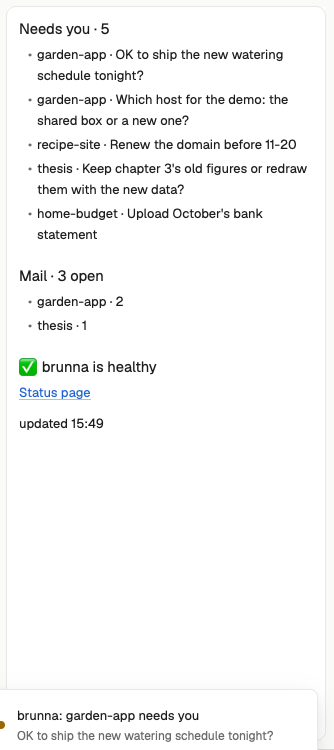

# brunna

A side panel for people who run many projects with AI agents and use [brunna](https://github.com/imaknas/brunna) to
keep them: what needs you across all your projects, the mail your agents left each other, and whether brunna's
nightly work is healthy, refreshed once a minute, with a toast when something new needs you.

## What you see

One panel on the right, 320 px wide, on the theme's `surface` background, 12 px padding, 13 px text in the theme's
`foreground`. It is one scrollable markdown text, top to bottom:

- A heading (`###`) **Needs you · N**: the owner's open items (to-dos and questions from every project), newest
  first, at most 8 lines `- project · text` (text cut at 120 characters); when there are more, a line
  `… N more (brunna owner list)`.
- A heading **Mail · N open**: one line per project with open letters, `- project · count`.
- A heading for health: `✅ brunna is healthy`, `⚠️ brunna has problems` or `brunna: status not known yet`, then up
  to 5 of the problems (`bad` alerts) and, when the scheduler has stopped, `the scheduler has not ticked since …`.
- `Status page`, a link, when the page can be opened from this computer.
- `updated HH:MM`, and the last error when a refresh failed.

Project names, item texts, alerts and errors are escaped: they show as written, never as markdown (a `~` in a
to-do is not strikethrough).

Before the first answer it shows `brunna…` in the theme's `muted` color. Without brunna it says how to install it;
on an instance that isn't set up, to run `brunna init`.

## How it behaves

- Every 60 seconds it runs `brunna glance --json` and redraws. Agent states (working, blocked, done, idle) are not
  shown: herdr's own sidebar has them; this panel is about what brunna keeps across sessions.
- When an item that wasn't in the previous answer needs you, a toast (`notify`, level `warning`): `brunna: <project>
  needs you` with the item's text, or `brunna: N new things need you`; never on the first load, at most one a minute.
- The `Status page` link opens in the browser (markdown links open natively).
- The command `brunna.refresh` (bind it in `keys.json`, e.g. `"global": { "ctrl-alt-b": "brunna.refresh" }`) refreshes
  at once.

## Built from

- `mods/brunna/main.js`: a `View` with `init` (first refresh, `cx.timer.every(60000, …)`, a `cx.spawn` loop on
  `nextCommand()`) and `render` (`v_flex` root, `TextView.markdown("brunna", text).scrollable(true)`).
- `mods/brunna/mod.json`: `{ "place": "right", "size": 320 }`.
- `herdr` functions: `exec`, `notify`, `props`, `theme`, `nextCommand`. `gpui-kit`: `View`, `div`. `gpui-base`:
  `v_flex`, `TextView`.
- Program: `brunna glance --json` (`exec`), tried as `brunna` on PATH, then `$HOME/.local/bin/brunna` through `sh -c`.
  Its output is the glance.v1 contract (`contracts/glance.v1.schema.json` in brunna's repo): `set_up`, `needs_you`
  (`kind`, `project`, `id`, `text`, `since`), `mail` (`total`, `projects`), `health` (`state`, `alerts`, `as_of`),
  `scheduler` (`last_tick`, `alive`), `status_page` (`url`, `local_to`).
- Props (optional): `cli`, the absolute path of brunna's command; `machine`, a herdr machine name when brunna runs on
  another computer (passed as `exec`'s `on`).

## Watch out

- The mod runs a program (`brunna`) on this computer, or on `machine`. It reads nothing else and reaches no network.
- `exec` runs with the user's environment, but an app started from the GUI may lack `~/.local/bin` on PATH: hence
  the second try.
- A status page `local_to: "hub"` (no URL set in brunna's settings) is on the hub machine's localhost: with `machine`
  set the link is left out, since it would open this computer's localhost.
- Mod commands: herdr's guide writes them `<mod>.<command>` (here `brunna.refresh`); a comment in older `herdr.d.ts`
  says `<mod>:<command>`. Follow the guide.
- Alerts and owner items come from brunna's last scheduler tick (up to 15 minutes old; `health.as_of`); mail is live.
- Item texts are in the language the projects write their notes in.
- TextView shows `**bold**` and `_italics_` as plain text: structure comes from `###` headings and the ` · `
  separators.

## Done when

- `herdr-app check ~/.config/herdr-app/mods/brunna` passes.
- With brunna set up, the panel lists the same count under "Needs you" as `brunna glance` prints in a terminal.
- Sending a test question to the owner (`brunna send --to owner --type question --text "test"` in a project) makes
  a toast within two minutes, and closing it (`brunna send --to owner --type done --question <id>`) removes the line at
  the next refresh.
- Renaming `brunna` off PATH and `~/.local/bin` shows the install hint instead of an error trace.
